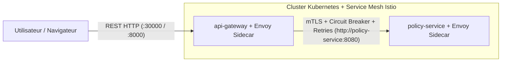
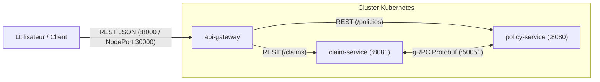

# 🚗 Suivi Chronologique du Projet : Gestion des Polices et Sinistres Auto (Microservices)

- **Dépôt GitHub** : `https://github.com/RobotTopDZ/Auto-Policy-and-Claims-Management-prog-distr-`
- **Branche** : `monsef`
- **Docker Hub** : `monci2004` (`monci2004/policy-service:1.0`, `monci2004/api-gateway:1.0`)
- **Stack Technique** : Python 3.11, FastAPI, Uvicorn, HTTPX, Docker, Kubernetes (Minikube), REST & gRPC (prévu entre microservices)

---

## 🏗️ Partie 1 : Historique Chronologique des Étapes et des Commits Réalisés

### Étape 1 — Développement initial du microservice `policy-service` (API REST)
* **Commit** : `cc82360` — *"initial commit for policy-service PY-FastAPI"* (puis création de la branche `monsef`)
* **Ce qui a été fait** :
  * Création du modèle [`Policy`](policy-service/models/policy.py) et de son [`PolicyBuilder`](policy-service/models/policy.py) (équivalent Python des annotations Lombok `@Data`, `@NoArgsConstructor`, `@AllArgsConstructor`, `@Builder` et constructeur simplifié à 4 arguments).
  * Implémentation du contrôleur REST [`policy_controller.py`](policy-service/controllers/policy_controller.py) exposant toutes les opérations CRUD sur `/policies` :
    * `GET /policies` (avec filtres optionnels `status` et `clientId`)
    * `GET /policies/{policy_id}`
    * `POST /policies`
    * `PUT /policies/{policy_id}`
    * `PATCH /policies/{policy_id}/status`
    * `DELETE /policies/{policy_id}`
  * Création du point d'entrée [`main.py`](policy-service/main.py) sur le port `8080` avec l'endpoint `/health` et la documentation Swagger (`/docs`).
  * Création de l'environnement virtuel `.venv` et test local sur `http://localhost:8080`.

---

### Étape 2 — Restructuration de l'architecture en Monorepo Multi-Microservices
* **Commit** : `01d4695` — *"reinitialisation of the git in the root of the services"*
* **Ce qui a changé par rapport à l'étape 1** :
  * Au départ, les fichiers de `policy-service` et le dépôt `.git` étaient placés directement dans le dossier du premier service (architecture monolithique).
  * **Changement effectué** : Déplacement du dépôt `.git` à la **racine du workspace** (`gestion-polices-sinistres-auto/`) et isolation complète du premier microservice dans son propre sous-dossier [`policy-service/`](policy-service/).
  * Ajout d'un fichier [`.gitignore`](.gitignore) à la racine pour exclure `.venv/` et `__pycache__/` du dépôt GitHub.
  * Cette structure permet d'accueillir proprement plusieurs microservices indépendants (`policy-service/`, `api-gateway/`, `claim-service/`).

---

### Étape 3 — Conteneurisation Docker de `policy-service` et Push sur Docker Hub
* **Commit** : `f57535d` — *"adding Dockerfile for the first service"*
* **Ce qui a changé par rapport à l'étape 2** :
  * Ajout de [`policy-service/Dockerfile`](policy-service/Dockerfile) basé sur l'image officielle légère `python:3.11-slim`.
  * Ajout de [`policy-service/.dockerignore`](policy-service/.dockerignore) pour optimiser la taille de l'image.
  * Construction de l'image Docker `monci2004/policy-service:1.0`, test en conteneur local et **push sur Docker Hub** (`docker push monci2004/policy-service:1.0`).

---

### Étape 4 — Premier déploiement Kubernetes (Minikube) de `policy-service`
* **Commit** : `b585b87` — *"adding the yaml file"*
* **Ce qui a changé par rapport à l'étape 3** :
  * Création du manifeste Kubernetes unique [`policy-service/deployment.yaml`](policy-service/deployment.yaml) regroupant :
    * Un objet `Deployment` (`replicas: 1`) téléchargeant l'image `monci2004/policy-service:1.0` depuis Docker Hub avec des sondes de santé (`readinessProbe` et `livenessProbe` sur `/health`).
    * Un objet `Service` initialement de type `NodePort` (`8080:30080/TCP`) pour tester l'accès direct au microservice sur Kubernetes.

---

### Étape 5 — Choix d'architecture hybride (REST Externe / gRPC Interne)
* **Commit** : `8f2559d` — *"completing the policy service with the docker files and the deployment file for kubernetes, and adding comments to prepare for the 2nd service"*
* **Ce qui a changé par rapport à l'étape 4** :
  * Définition de la stratégie de communication du système distribué :
    1. **REST (HTTP/JSON)** entre l'**Utilisateur / API Gateway** et chaque microservice.
    2. **gRPC (HTTP/2 + Protobuf)** pour la communication **interne** entre les microservices (`claim-service` $\leftrightarrow$ `policy-service`).
  * Mise à jour de [`policy-service/main.py`](policy-service/main.py) et [`policy-service/deployment.yaml`](policy-service/deployment.yaml) avec les notes d'architecture et l'emplacement prévu pour le futur serveur gRPC (port `50051`).

---

### Étape 6 — Création et Déploiement du microservice `api-gateway` (État actuel)
* **Commit** : `dc39191` — *"adding the microservice of API Gateway"*
* **Ce qui a changé par rapport à l'étape 5** :
  * Création d'un nouveau microservice dédié [`api-gateway/`](api-gateway/) servant de **point d'entrée unique** (Single Entry Point / Reverse Proxy) sur le port `8000` :
    * [`api-gateway/main.py`](api-gateway/main.py) : Route toutes les requêtes clientes `/policies/*` vers `http://policy-service:8080` et prépare le routage `/claims/*` vers `http://claim-service:8081`. Fournit également un Swagger UI unifié (`/docs`) et un healthcheck agrégé (`/health`).
    * [`api-gateway/Dockerfile`](api-gateway/Dockerfile) & [`api-gateway/deployment.yaml`](api-gateway/deployment.yaml) : Image `monci2004/api-gateway:1.0` poussée sur Docker Hub et déployée sur Kubernetes.
  * **Sécurisation réseau dans [`policy-service/deployment.yaml`](policy-service/deployment.yaml)** :
    * Le `Service` Kubernetes de `policy-service` est passé de `type: NodePort` à **`type: ClusterIP`**.
    * Désormais, `policy-service` n'est plus exposé directement à l'extérieur : **seule l'`api-gateway` est exposée en `NodePort` (`8000:30000/TCP`)**, et elle communique en interne avec `policy-service` via le DNS Kubernetes (`http://policy-service:8080`).

---

## 📐 Schéma de l'Architecture Actuelle (Étape 6 + Service Mesh Istio)

---

### Étape 7 — Intégration du Service Mesh (Istio) (En cours)
* **Ce qui a changé par rapport à l'étape 6** :
  * Mise aux normes Istio des manifestes [`policy-service/deployment.yaml`](policy-service/deployment.yaml) et [`api-gateway/deployment.yaml`](api-gateway/deployment.yaml) :
    * Ajout du label `version: v1` sur les `Deployment` et les `Pod` (requis par Istio pour les `subsets` et l'observabilité Kiali).
    * Renommage des ports de Service avec le préfixe `http-` (`http-rest`, `http-gateway`) pour la détection automatique du protocole par les proxies Envoy.
  * Création du fichier [`service-mesh/istio-mesh.yaml`](service-mesh/istio-mesh.yaml) définissant :
    * **`PeerAuthentication`** (`policy-service-mtls`) : Force le chiffrement **mTLS (`STRICT`)** pour toutes les communications entrantes vers `policy-service`.
    * **`DestinationRule`** (`policy-service-destination`) : Configure le tunnel `ISTIO_MUTUAL`, le Load Balancing `ROUND_ROBIN` et un **Circuit Breaker** (`outlierDetection` qui éjecte un pod pendant 30s après 3 erreurs 5xx consécutives).
    * **`VirtualService`** (`policy-service-vs`) : Configure un timeout de `5s` et des **Retries automatiques** (`3 tentatives` de `2s` chacune en cas d'erreur réseau ou `5xx`).

---

## 🚀 Partie 2 : Feuille de Route des Étapes Suivantes (À venir)

### Étape 8 — Développement du 2e microservice : `claim-service` (Gestion des Sinistres)
* Création du modèle [`Claim`](claim-service/models/claim.py) et de son `ClaimBuilder` (`claimId`, `policyId`, `description`, `claimedAmount`, `approvedAmount`, `status`, `incidentDate`, `declarationDate`, `rejectionReason`).
* Création du contrôleur REST [`claim_controller.py`](claim-service/controllers/claim_controller.py) sur le port `8081` (`GET /claims`, `GET /claims/{id}`, `POST /claims`, `PUT /claims/{id}`, `PATCH /claims/{id}/status`, `DELETE /claims/{id}`).
* **Rappel architecture** : Les routes REST de `claim-service` serviront aux requêtes venant de l'utilisateur (via l'`api-gateway`).

---

### Étape 9 — Communication Inter-Microservices en gRPC (`claim-service` $\leftrightarrow$ `policy-service`)
* Définition du contrat **Protocol Buffers** (`protos/policy.proto`) contenant :
  * Le service `PolicyGrpcService` avec la méthode distante `rpc GetPolicy (PolicyRequest) returns (PolicyResponse)`.
* Génération du code Python gRPC (`grpcio`, `grpcio-tools`) dans `policy-service` et `claim-service`.
* **Côté `policy-service`** :
  * Démarrage d'un serveur gRPC sur le port **`50051`** en parallèle du serveur FastAPI (`8080`).
* **Côté `claim-service`** :
  * Lors d'un `POST /claims` (déclaration d'un sinistre), `claim-service` appellera `policy-service:50051` **en gRPC** pour :
    1. Vérifier que la police `policyId` existe.
    2. Vérifier que son statut est `ACTIVE`.
    3. Récupérer la franchise (`deductible`) et le plafond (`coverageLimit`) pour calculer automatiquement le montant remboursé (`approvedAmount`).

---

### Étape 10 — Conteneurisation et Déploiement Kubernetes Complet (`claim-service` + gRPC)
* Mise à jour de l'image `monci2004/policy-service:2.0` (incluant le serveur gRPC `50051`) et exposition du port `50051` dans [`policy-service/deployment.yaml`](policy-service/deployment.yaml).
* Création du `Dockerfile` de `claim-service`, push de l'image `monci2004/claim-service:1.0` sur Docker Hub.
* Création de `claim-service/deployment.yaml` (en `type: ClusterIP` sur le port `8081`, avec la variable d'environnement `POLICY_GRPC_TARGET=policy-service:50051`).
* Déploiement sur Kubernetes et tests de bout en bout via l'`api-gateway` !

---

## 🎯 Schéma de l'Architecture Finale Cible

